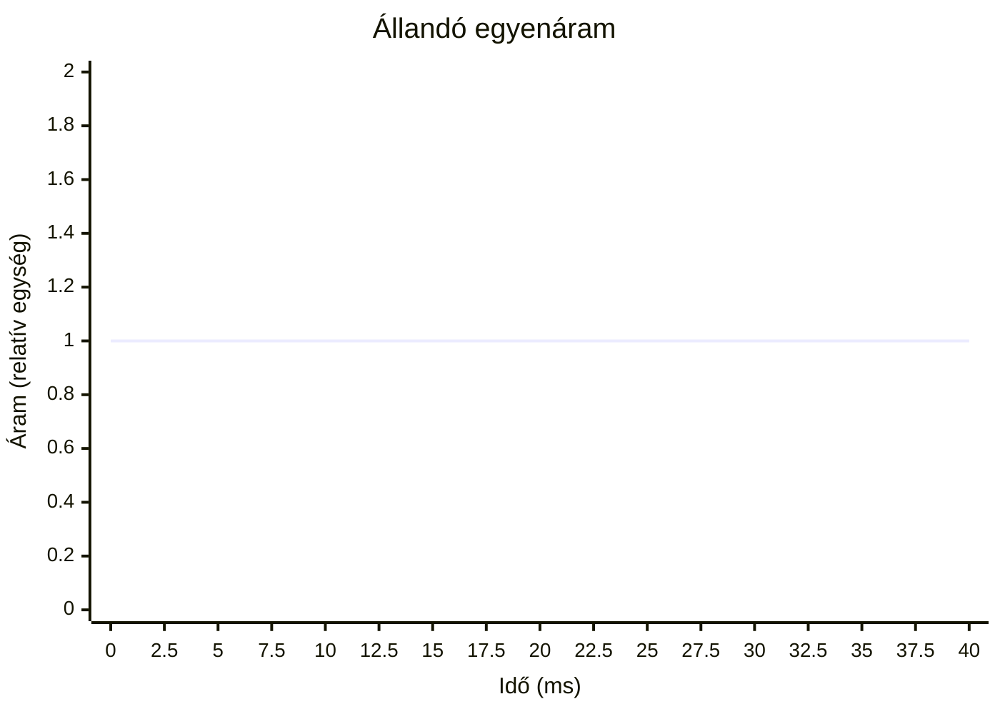
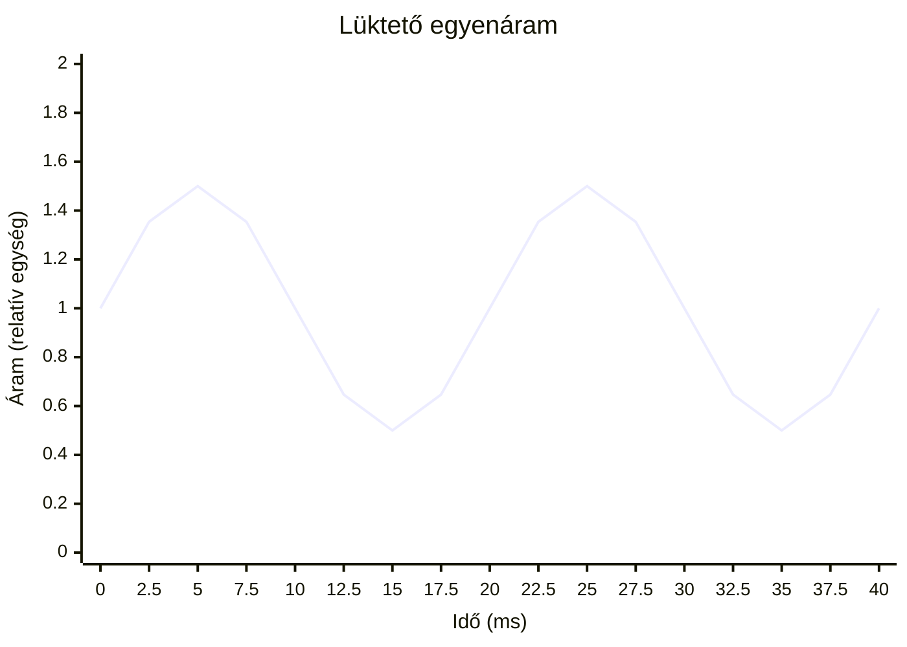
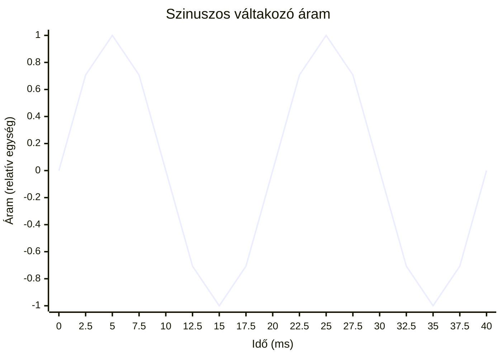
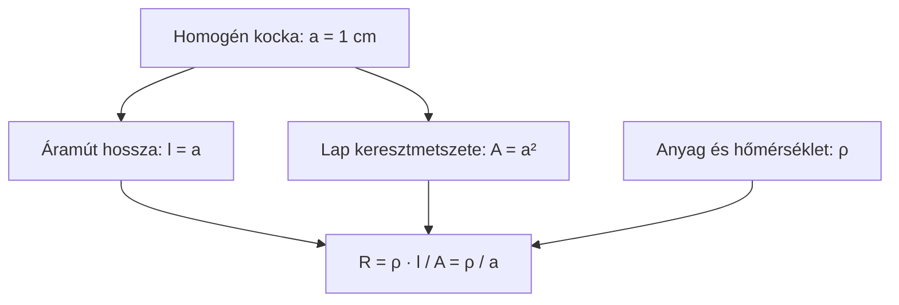
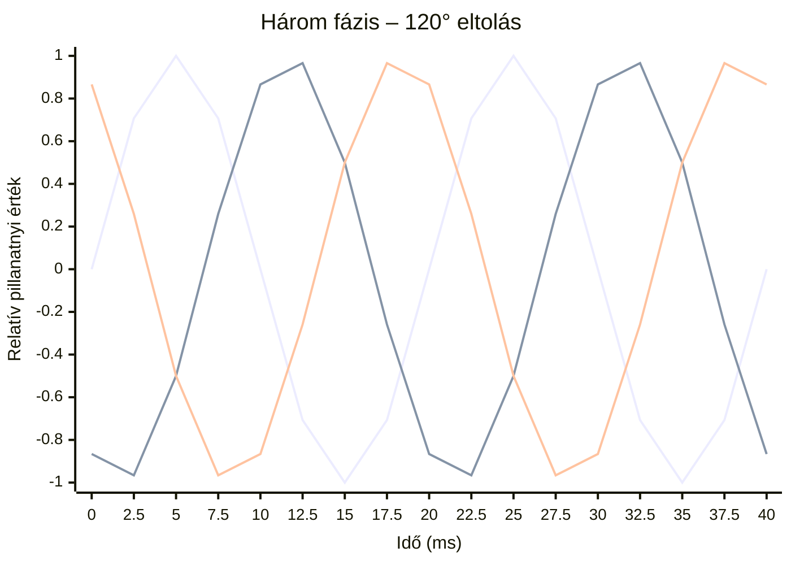
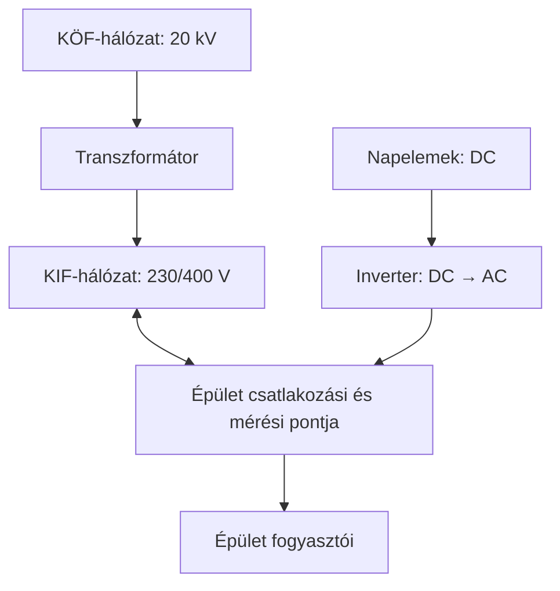
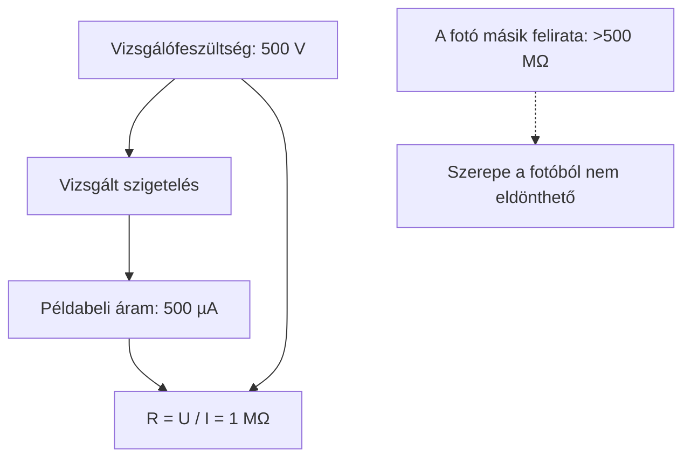
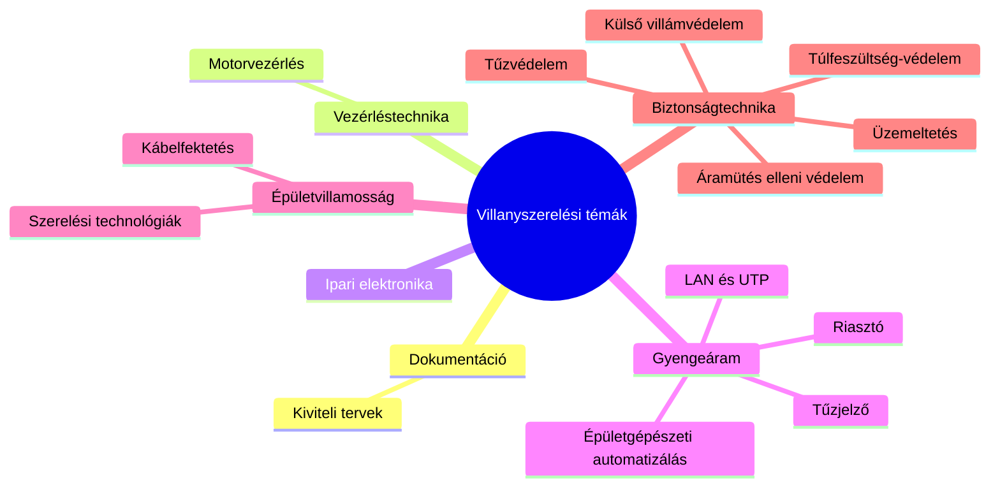

# Villanyszerelési és elektrotechnikai alapok

## Összefogott tananyag a 2026. szeptember 27-i óra három leirata és hat táblafotója alapján

**Forrásfelvételek kezdete:** 09:47, 10:18 és 12:14.  
**Fotós kiegészítés:** a 16. fejezetben hat táblafotó szöveges feldolgozása és forrásazonosítása.  
**Szerkesztés:** témák szerinti rendezés, ismétlések összevonása, köznyelvi és trágár megfogalmazások szakmai átfogalmazása. A bemutatkozások, szervezési ügyek és szüneti beszélgetések kimaradtak; a közéjük ékelt szakmai magyarázatok megmaradtak.

Ez tanulási jegyzet, nem egy konkrét berendezés kivitelezési terve. A videókon bemutatott kapcsolások rajza és a hangfelvételek nem álltak rendelkezésre: ezeknél csak a leiratból rekonstruálható tanulság szerepel.

**Újrarajzolt ábrák:** a dokumentum Mermaid-diagramokat tartalmaz. Mermaid-kompatibilis Markdown-megjelenítőben ábraként látszanak; más szerkesztőben a szerkeszthető diagramkód jelenhet meg.

### Jelölések

- **Tanári magyarázat / példa:** az órán elhangzott gondolat szerkesztett, többnyire nem szó szerinti változata.
- **[Kiegészítés]:** az órán ebben a formában nem szereplő magyarázat, képlet vagy új példa.
- **[Pontosítás]:** túl általános, pontatlan vagy félreérthető állítás helyesbítése. Az eredeti gondolatot is megnevezzük.
- **[Leirat bizonytalan]:** a szöveg vagy a videó hiányában nem állapítható meg biztosan, mire gondolt a tanár.

A jelöletlen alapmagyarázat a három leirat szakmai tartalmának összefoglalása. A pontosított részeknél a helyes megfogalmazást érdemes megtanulni.

---

## Tartalom

1. [Szakmai szemlélet és szóhasználat](#1-szakmai-szemlélet-és-szóhasználat)
2. [Töltés, villamos tér és feszültség](#2-töltés-villamos-tér-és-feszültség)
3. [Áram és töltéshordozók](#3-áram-és-töltéshordozók)
4. [Energiaforrások és energiaátalakítás](#4-energiaforrások-és-energiaátalakítás)
5. [Vezetők, szigetelők és félvezetők](#5-vezetők-szigetelők-és-félvezetők)
6. [Ellenállás és fajlagos ellenállás](#6-ellenállás-és-fajlagos-ellenállás)
7. [Réz, alumínium és kötéstechnika](#7-réz-alumínium-és-kötéstechnika)
8. [Váltakozó feszültség és effektív érték](#8-váltakozó-feszültség-és-effektív-érték)
9. [Áramütés, védővezetők és hálózati rendszerek](#9-áramütés-védővezetők-és-hálózati-rendszerek)
10. [Áram-védőkapcsoló és védőlábbeli](#10-áram-védőkapcsoló-és-védőlábbeli)
11. [Kismegszakítók és vezetékméretezés](#11-kismegszakítók-és-vezetékméretezés)
12. [Kapcsolók, relék és terheléstípusok](#12-kapcsolók-relék-és-terheléstípusok)
13. [Villamos ív, DC és napelemes rendszerek](#13-villamos-ív-dc-és-napelemes-rendszerek)
14. [Képletgyűjtemény és önellenőrzés](#14-képletgyűjtemény-és-önellenőrzés)
15. [Könyvek, bizonytalanságok és ellenőrző források](#15-könyvek-bizonytalanságok-és-ellenőrző-források)
16. [Táblafotók alapján rögzített tartalom](#16-táblafotók-alapján-rögzített-tartalom)

---

## 1. Szakmai szemlélet és szóhasználat

A tanár visszatérő üzenete: a szakember ne csak bekötni tudjon egy eszközt, hanem értse a működését és a választásának indokát. A „mindig így szoktuk” nem helyettesíti a számítást, az adatlapot és az ellenőrzést.

A fedél mögötti kivitelezés minősége is számít. Az áramkörök legyenek tartósan és egyértelműen azonosíthatók, a kötések pedig rendezettek és ellenőrizhetők. A pontos követelményeket mindig az adott berendezésre alkalmazandó előírások alapján kell megállapítani.

| Köznyelvi kifejezés | Szakmailag pontosabb megfogalmazás |
|---|---|
| „Van áram a konnektorban?” | „Van feszültség a dugaszolóaljzat megfelelő pontjai között?” |
| Villanyóra | Fogyasztásmérő |
| Föld / védőföld, amikor a PE-re gondolunk | Védővezető, PE |
| FI-relé | Áram-védőkapcsoló, ÁVK; angol gyűjtőnév: RCD |
| Újratölthető elem | Akkumulátor / másodlagos cella |
| Váltóáram | A jegyzetben: váltakozó áram, AC |

> **[Pontosítás]** A „földelés” és „védőföldelés” valódi szakmai fogalmak. Nem tiltott szavak: azt kell megkülönböztetni, hogy egy adott vezető PE, földelővezető vagy más rendeltetésű vezető. A köznyelvi „váltóáram” miatt sem érdemes elveszíteni a tartalmat; a tananyag következetesen a váltakozó áram elnevezést használja.

### Mérés: feszültség vagy áram?

A két mennyiséget eltérő módon mérjük.

> **[Kiegészítés]** Feszültségmérőt a vizsgált két pont közé, párhuzamosan kapcsolunk. Hagyományos árammérőt az áramkörbe sorosan kapcsolunk; a lakatfogó megfelelő kialakítás esetén a vezető körül mér. Árammérő állásban a műszert közvetlenül egy hálózati feszültségforrásra kötni zárlatot és súlyos sérülést okozhat. A mérési mód, a mérővezeték csatlakozóhelye és a műszer minősítése egyaránt számít.

## 2. Töltés, villamos tér és feszültség

### 2.1. Villamos töltés

**Tanári magyarázat:** a töltés a protonok és elektronok villamos kölcsönhatásának alapja. A tanár szemléltetésre a Bohr-féle atommodellt használja: atommag protonokkal és neutronokkal, körülötte elektronokkal.

| Részecske | Villamos töltés |
|---|---|
| Proton | Pozitív |
| Elektron | Negatív |
| Neutron | Semleges |

A töltés jele **Q**, mértékegysége **coulomb, C**.

> **[Pontosítás]** A töltés a részecskék fizikai tulajdonsága; nem csak protonnak és elektronnak lehet töltése. A Bohr-modell oktatási szemléltetés, nem az atom teljes mai leírása. Az elektronokat nem szó szerint apró bolygókként kell elképzelni.

### 2.2. Villamos tér

**Tanári megfogalmazás:** a térnek az a része, ahol a töltésre villamos erő hat.

> **[Kiegészítés]** A villamos térerősség jele **E**. Megadja az egységnyi pozitív próbatöltésre ható erőt: \(E=F/q\). Mértékegysége N/C, illetve V/m. Az átütési szilárdságnál is térerősségről beszélünk.

### 2.3. Feszültség: három megközelítés

1. **Két pont közötti potenciálkülönbség.** Ez különösen hasznos az érintési feszültség megértéséhez.
2. **Egységnyi töltésre jutó munka.** A villamos mező töltésmozgatás közben munkát végezhet.
3. **A forrás áramlást létrehozó képessége.** A tanár gyakorlati szemléltetése szerint a forrás feszültsége megfelelő körülmények között töltésáramlást hozhat létre.

A feszültség jele **U**, mértékegysége **volt, V**.

> **[Kiegészítés]** A munka és töltés kapcsolatát egyszerű esetben \(U=W/Q\) írja le. Így \(1\text{ V}=1\text{ J}/\text{C}\). Az előjel a választott pontsorrendtől függ.

> **[Pontosítás]** Az „áramlást létrehozó képesség” szemléletes magyarázat, nem teljes definíció. Feszültség nyitott áramkörben is lehet, miközben a fogyasztón nem folyik áram. Áramkörelméletben az ideális feszültségforrás és áramforrás külön fogalom; a tanár itt az „áramforrás” szót általános energiaforrás értelemben használja.

## 3. Áram és töltéshordozók

### 3.1. Villamos áram

**Tanári meghatározás:** töltéshordozók tartós áramlása.

> **[Pontosítás]** Általánosabban: töltéshordozók rendezett mozgása. Áram rövid ideig, impulzusszerűen is folyhat, tehát a „tartós” szó nem feltétel minden esetben.

Az áramerősség jele **I**, mértékegysége **amper, A**.

> **[Kiegészítés]** Állandó áramnál \(I=Q/t\). Egy amper azt jelenti, hogy másodpercenként egy coulomb töltés halad át a vizsgált keresztmetszeten.

| Közeg | Jellemző töltéshordozó |
|---|---|
| Fémvezető | Elektron |
| Elektrolit | Pozitív és negatív ion |
| Folyékony fém, például higany | Elektron |
| **[Kiegészítés]** Félvezető | Elektron és lyuk |
| **[Kiegészítés]** Ionizált gáz | Elektron és ion |

Az **ion** elektronhiány vagy elektrontöbblet miatt töltéssel rendelkező atom vagy atomcsoport. Elektronhiány esetén pozitív, elektrontöbblet esetén negatív.

### 3.2. Egyenáram, lüktető egyenáram, váltakozó áram

- **DC, egyenáram:** az áram iránya nem változik meg.
- **Lüktető egyenáram:** az erőssége változik, akár időnként nulla is lehet, de nem fordul meg az iránya.
- **AC, váltakozó áram:** az iránya időben váltakozik; az órán periodikus jelalakok szerepelnek.

**Tanári példa:** attól, hogy a grafikon hullámos, még nem biztos, hogy váltakozó áram. Ha a jel végig a nulla egyik oldalán marad, egyirányú, lüktető áramról lehet szó.

> **[Kiegészítés]** Fémekben az elektronok rendezett mozgásának iránya ellentétes a megállapodás szerinti áramiránnyal. AC-n az elektronok rendezett mozgása oda-vissza történik.

### Újrarajzolt táblai jelalakok – T1

**[Táblafotó alapján – újrarajzolva]** Az alábbi görbék a tábla három jelalakját adják vissza. **[Kiegészítés]** A számozott tengelyek és amplitúdók szemléltető, választott értékek, nem mérések. A DC-görbéhez ugyanazt az időskálát használjuk összehasonlításra.

Az áram erőssége és iránya állandó.

Az erősség változik, de a jel nem megy a nulla alá: az irány nem fordul meg.

A jel pozitív és negatív is: az áram iránya félperiódusonként megfordul. A vonaldiagram mintapontokat köt össze; a valós ideális szinusz folytonosan sima.

### 3.3. Miért gyullad fel gyorsan a lámpa?

**Tanári hasonlat:** az elektronok nem szaladnak végig fénysebességgel a vezetéken; a változás hatása terjed gyorsan.

> **[Pontosítás]** A vezető elektronjainak átlagos sodródási sebessége tipikus vezetéknél jóval kisebb lehet az órán említett néhány m/s-nál, gyakran mm/s nagyságrendű vagy annál kisebb. Az elektromágneses változás terjedése viszont nagyon gyors, a vezeték és környezete által meghatározott sebességgel. A „hátulról meglökik egymást” hasonlat csak szemléltetés.

## 4. Energiaforrások és energiaátalakítás

**Tanári alapgondolat:** a villamos energiaforrásban más energia alakul villamos energiává, a fogyasztóban pedig villamos energia alakul más formává.

| Példa az óráról | Energiaátalakítás |
|---|---|
| Generátor, dinamó | Mechanikai → villamos |
| Galvánelem | Kémiai → villamos |
| Akkumulátor kisütése | Tárolt kémiai → villamos |
| Piezoelektromos gyújtó | Mechanikai → villamos |
| Hőelem, termoelektromos generátor | Hőmérséklet-különbség segítségével hő → villamos |
| **[Pontosítás]** Napelem | Elektromágneses sugárzás energiája → villamos |
| Villanybojler, infrapanel | Villamos → hő |
| Villanymotor | Villamos → mechanikai |
| Lámpa | Villamos → fény és hő |

### 4.1. Elem és akkumulátor

A tanár a nem újratölthető elemet és a tölthető akkumulátort különíti el. Az akkumulátor energiatároló: töltéskor energiát vesz fel, kisütéskor leadja.

> **[Pontosítás]** Kisütéskor az akkumulátor is kémiai villamos energiaforrás. A „primer cella” és „primer energiaforrás” eltérő fogalmak. A nem újratölthető elem gyártáskor beépített kémiai energiát használ fel; az akkumulátor másodlagos cella. A működés mindkettőnél elektrokémiai, de az akkumulátor reakciói megfelelő feltételek között újratöltéssel visszafordíthatók. Nem tölthető elemet nem szabad akkumulátorként tölteni.

### 4.2. Napelem és erőművek

A napelem fotovoltaikus eszköz. Az órán a fotonok és a félvezető kapcsolatán keresztül jelenik meg a magyarázat.

> **[Pontosítás]** A „fényenergia nincs” állítás nem helyes: a fény energiát hordozó elektromágneses sugárzás. A napelem működését nem klasszikus golyóütközésként vagy egyszerű mechanikai energiaátalakításként tanuljuk. A foton energiája \(E=h\nu\); elnyelődése töltéshordozókat hozhat létre. A cella belső szerkezete lehetővé teszi ezek szétválasztását és az energia kinyerését. [F1]

A hidegebb cella azonos besugárzás mellett általában kedvezőbb teljesítményt ad. **Ez nem jelenti, hogy télen több az éves időszakra vetített termelés:** a napsütés időtartama és a besugárzás is számít. [F1]

**Tanári példák:** vízerőműnél a víz helyzeti és mozgási energiája hajtja a turbinát; atomerőműben a hőből gőz, majd turbinamozgás és generátor segítségével villamos energia lesz.

> **[Pontosítás]** Az atomerőmű teljes lánca nukleáris → hő → mechanikai → villamos. A generátor közvetlenül mechanikai energiát alakít át, de az elsődleges forrás ettől még nukleáris.

### 4.3. Piezoelektromos jelenség

Bizonyos anyagok mechanikai deformációja töltésszétválást és feszültséget hozhat létre.

**Tanári példák:** piezogyújtó, kristálymikrofon és kristályhangszedő. A fordított jelenségnél feszültség hatására alakváltozás történik: ezt használhatja piezohangjelző.

> **[Pontosítás]** A jelenség felfedezése Pierre és Jacques Curie nevéhez kapcsolódik. A hangszedő példája nem minden lemezjátszóra igaz: vannak más elven működő hangszedők is. A mélyhang-előállítás korlátai nem vezethetők le pusztán a „kicsi elmozdulás = rövid hullámhossz” mondatból.

### 4.4. Hőelem, lángőr és Peltier-modul

**Tanári példa:** egy hagyományos gázkészülék hőelemes lángőre a láng melegéből kis villamos feszültséget hoz létre. Ez elektromágneses szelepet tarthat nyitva. A láng megszűnése után a hőelem lehűl, a szelep elenged és megszakítja a gázellátást.

> **[Pontosítás]** A hőelem működéséhez két különböző anyag és hőmérséklet-különbség tartozik: ez a **Seebeck-hatás**. Nem minden gázkészülék ilyen lángőrt használ. A J és K hőelemtípus eltérő anyagpárt és karakterisztikát jelent. [F2]

**Tanári példák a termoelektromos eszközökre:** szivargyújtós hűtőtáska, kályha tetején működő ventilátor, radioizotópos generátor.

> **[Kiegészítés]** A **Peltier-hatás** során a villamos áram hőt szállít: az egyik oldal hűlhet, a másik melegszik. A meleg oldal hőelvezetése szükséges. Hőmérséklet-különbséggel villamos energiát előállítani Seebeck-hatással lehet; a generátoros üzemre méretezett modul előnyös. A kályhaventilátor nem energia nélkül működik: a kályha hőjének egy részét használja fel. [F2]

### 4.5. Elektromágneses indukció

A villamosság és mágnesesség összefügg: áram mágneses teret hozhat létre, változó mágneses hatás feszültséget indukálhat.

> **[Kiegészítés]** A pontos kulcs a mágneses fluxus változása. Egy mozdulatlan mágnes és mozdulatlan tekercs önmagában nem ad folyamatos energiát. A generátor hajtásához mechanikai energiát kell bevinni.

## 5. Vezetők, szigetelők és félvezetők

### 5.1. Vezetők

A fémekben sok mozgásképes töltéshordozó van, ezért kis villamos hatásra is létrejöhet áram.

**Tanári sorrend a szokásos tiszta fémek között:** ezüst, réz, arany. Az aranyozás előnye nem az, hogy az arany jobb vezető a réznél, hanem a korrózióállósága és a megbízható érintkezés.

> **[Pontosítás]** Ez a sorrend a szokásos körülmények közötti anyagokra vonatkozik, nem minden létező anyagra és állapotra. Az ezüst sötétedése gyakran szulfidképződés, nem egyszerűen oxidáció. Ezüstöt érintkezőanyagként is használnak; az arany sem teljesen reakcióképtelen.

### 5.2. Szigetelők és átütési szilárdság

A szigetelőben kevés szabad töltéshordozó van. A tervezett körülmények között az áramvezetése nagyon kicsi.

**Tanári példák:** üveg, kerámia, levegő, megfelelően száraz papír és olajjal impregnált papírszigetelés.

Az **átütési szilárdság** a szigetelő által elviselhető villamos térerősséghez kapcsolódó határjellemző. Túl nagy igénybevételnél átütés következhet be.

> **[Pontosítás]** A levegőre elhangzott kb. 20 kV/cm csak durva szemléltető érték. Az átütés függ a nyomástól, páratartalomtól, elektródaalakoktól és távolságtól is; ebből nem szabad biztonságos közelítési távolságot számolni. Nagyfeszültségnél közvetlen érintés nélkül is létrejöhet átütés.

A szilárd szigetelés átütése gyakran maradandó károsodás. Egyes fémezett fóliakondenzátorok helyi hibája öngyógyulással megszűnhet.

> **[Pontosítás]** Az MKT fémezett poliészter fóliakondenzátort jelöl, nem egyszerűen „metálpapírt”. A papír nedvesség hatására jelentősen veszíthet szigetelőképességéből. Nem minden modern oszlopszigetelő üveg vagy kerámia: kompozit kivitel is létezik.

### 5.3. Félvezetők

**Tanári példák:** szilícium, germánium, dióda, tranzisztor, P- és N-típusú anyag, PN-átmenet.

> **[Pontosítás]** A félvezető nem egyszerűen „szobahőmérsékleten szigetelő, melegen vezető”. Vezetőképességét a hőmérséklet, az adalékolás, a fény és más körülmények is befolyásolják. A „szennyezés” itt szabályozott **adalékolás**, nem véletlen szennyeződés. A dióda megfelelő üzemi tartományban egyik irányban jól, a másikban sokkal kevésbé vezet; nem minden feszültségen tökéletes egyirányú szelep.

## 6. Ellenállás és fajlagos ellenállás

### 6.1. Ellenállás

**Tanári meghatározás:** a villamos áram áthaladásával szembeni akadályozó tulajdonság. Jele **R**, mértékegysége **ohm, Ω**.

Egy homogén vezető ellenállása az anyagtól, a hőmérséklettől és a méretektől függ:

\[
R=\rho\frac{l}{A}
\]

- \(l\): hossz; nagyobb hossz → nagyobb ellenállás.
- \(A\): keresztmetszet; nagyobb keresztmetszet → kisebb ellenállás.
- \(\rho\): fajlagos ellenállás, az anyag és hőmérséklet jellemzője.

### 6.2. Fajlagos ellenállás

Jele a görög **ró: ρ**. SI-mértékegysége Ω·m; vezetékek számításánál kényelmes az **Ω·mm²/m**.

| Anyag | Az órán használt közelítő érték, 20 °C-on |
|---|---:|
| Réz | 0,0175 Ω·mm²/m |
| Alumínium | 0,028 Ω·mm²/m |

> **[Pontosítás]** A fajlagos ellenállás nem egy darab vezető ellenállása: anyagjellemző, adott hőmérsékleten. Az 1 m élű kocka két szemközti lapja közötti ellenállása számszerű szemléltetés az Ω·m-ben megadott értékhez. Ω·mm²/m használatakor az 1 m hosszú, 1 mm² keresztmetszetű vezető a praktikus szemléltetés. \(1\,\Omega\cdot\mathrm{mm}^2/\mathrm{m}=10^{-6}\,\Omega\cdot\mathrm{m}\).

### A táblai kockarajz értelmezése – T6

**[Táblafotó alapján – szerkezeti ábraként újrarajzolva]** A fényképen 1 cm élű kocka szerepel; az ellenállást a két szemközti teljes lap között értelmezzük. Az alábbi ábra az ellenállás számításának kapcsolatait mutatja, nem perspektivikus kockarajz.

**[Kiegészítés]** A két mérési oldal a kocka szemközti lapja; a geometria és a fajlagos ellenállás együtt adja az ellenállást. Az 1 cm élhossz az Ω·cm egységben megadott érték szemléltetéséhez tartozik.

### 6.3. Tanári számítás: 100 m, 1,5 mm² rézvezető

\[
R=0{,}0175\frac{100}{1{,}5}\approx1{,}17\,\Omega
\]

A tanár ezzel azt szemlélteti, hogy a réz jó vezető: egy teljes, 100 méteres guriga ellenállása is csak valamivel több mint 1 Ω.

> **[Kiegészítés]** Ez egyetlen vezető ellenállása. Egy 100 m távolságra táplált egyfázisú fogyasztónál az oda- és visszavezető együtt közel 200 m. A fenti keresztmetszettel 10 A esetén a közelítő feszültségesés \(10\cdot2\cdot1{,}17\approx23{,}3\) V, a két vezető vesztesége \(10^2\cdot2{,}33\approx233\) W. Ez szemléltetés, nem ilyen áramkör ajánlása: a kis fajlagos ellenállás nem teszi jelentéktelenné a hosszú vezeték veszteségét.

### 6.4. Ohm-törvény és hőhatás

A tanár példája: **1 V hatására 1 Ω ellenálláson 1 A folyik.**

> **[Kiegészítés]** Ohmos fogyasztóra \(U=RI\), illetve \(I=U/R\). A vezető vagy kötés veszteségi teljesítménye \(P_\mathrm{veszt}=I^2R\). Emiatt a rossz kötés növekvő ellenállása jelentős helyi melegedést okozhat. Az áram megkétszerezése azonos ellenálláson négyszeres hőteljesítményt jelent.

## 7. Réz, alumínium és kötéstechnika

### 7.1. Réz és rézötvözetek

A villamos vezetékekben jellemzően nagy tisztaságú rezet használunk.

> **[Pontosítás]** A tanár által összekevert elnevezések: **vörösréz** a réz; **sárgaréz** jellemzően réz–cink ötvözet; a hagyományos **bronz** réz–ón ötvözet. Az ötvözetek vezetőképessége eltér a tiszta rézétől.

### 7.2. Alumínium: előnyök és nehézségek

**Tanári előnyök:** kis tömeg, kedvezőbb költség, nagy keresztmetszetű betáplálásoknál és távvezetékeknél előnyös lehet.

**Tanári figyelmeztetések:** oxidréteg, mechanikai sérülékenység, nyomás alatti alakváltozás és a kötések tartóssága.

> **[Pontosítás]** A nyomás alatti „megfolyás” itt képlékeny alakváltozást és kúszást jelent, nem olvadást. Az alumíniumötvözet és kapocskialakítás is számít. Nem igaz, hogy minden villamos alumíniumvezető Aldrey: ez egy Al–Mg–Si ötvözet neve, többek között légvezetékeknél használják. Más villamos alumíniumanyagok is léteznek.

A 20 °C-os értékek aránya:

\[
\frac{\rho_\mathrm{Al}}{\rho_\mathrm{Cu}}=\frac{0{,}028}{0{,}0175}=1{,}6
\]

**Tanári példák:** azonos hossz és közel azonos ellenállás elérésére 10 mm² rézhez 16 mm² alumínium, 16 mm² rézhez kb. 25 mm² alumínium áll közel.

> **[Pontosítás]** A „mindig egy mérettel nagyobb” nem általános méretezési szabály. Az ellenállás egyezése nem jelenti automatikusan azonos megengedett terhelést vagy minden szempontból helyettesíthető kábelt. Az árarányok az órán elhangzott tapasztalatok, nem aktuális árajánlatok.

### 7.3. Kötések és kontaktpaszta

Az alumínium oxidrétege védi a fémet, de az érintkezést ronthatja. A réz–alumínium kapcsolatnál megfelelő kötőelem szükséges; a két vezető puszta összetekerése nem megfelelő megoldás.

**Tanári példák:** Al/Cu bimetál toldóhüvely, alumíniumhüvelyes és réztalpú saru, megfelelő kontaktpaszta, előírt préselés.

> **[Pontosítás]** A kontaktpaszta nem tesz bármely kapcsot alumíniumhoz alkalmassá. A csupaszítás, oxideltávolítás, paszta, nyomaték vagy préselés módját az adott gyártó utasítása határozza meg. A kötőelem, vezetőfajta és keresztmetszet egymáshoz illeszkedjen.

**WAGO-példa, gyártói pontosítással:** a WAGO egyes 2273, 773, 222 és 224 sorozatú csatlakozói meghatározott feltételekkel, Alu-Plus pasztával használhatók tömör alumíniumhoz. A **221 sorozat alumíniumhoz nem megengedett, pasztával sem**. Az alkalmasságot cikkszám és adatlap alapján kell ellenőrizni, nem házszín alapján. A gyártó a tisztítást és az újraoxidálódás elleni kezelést is előírja. [F3]

## 8. Váltakozó feszültség és effektív érték

A hálózati névleges fázis–nulla feszültség **230 V effektív érték**, a frekvencia **50 Hz**.

| Mennyiség | Ideális szinuszos 230 V, 50 Hz jel |
|---|---:|
| Teljes periódus | 20 ms |
| Félperiódus | 10 ms |
| Nullátmenetek | 100/s |
| Pozitív csúcs | kb. +325 V |
| Negatív csúcs | kb. −325 V |
| Teljes periódus számtani átlaga | 0 V |

> **[Pontosítás]** A 230 V nem a pillanatnyi feszültség és nem a számtani átlag. Szinusznál \(U_\mathrm{csúcs}=\sqrt2\,U_\mathrm{eff}\). Az órán egyszer elhangzó 200 nullátmenet/s téves; 50 Hz-nél 100 van.

### 8.1. Mit jelent az effektív érték?

**Tanári ellenállásos példa:** 230 V effektív szinuszos AC ugyanazon az ellenálláson ugyanannyi idő alatt ugyanannyi hőt termel, mint 230 V DC.

> **[Kiegészítés]** Általánosan \(U_\mathrm{eff}=\sqrt{\frac1T\int_0^T u^2(t)\,dt}\). A hőhatásos összehasonlítás ellenállásos fogyasztóra érvényes; elektronikus lámpára vagy motorra nem jelenti azonos működés garantálását.

### 8.2. Villogás és stroboszkóphatás

**Tanári példák:** hagyományos izzó izzószála, fénycsöves műhelyvilágítás, forgó esztergatokmány és közvilágítás mellett furcsán forgónak látszó autókerék.

Az izzószál hőtehetetlensége csökkenti a fény ingadozását. Hálózati frekvenciához kötött fényingadozásnál a forgó géprész állónak vagy más sebességűnek tűnhet. Ezt nevezzük stroboszkóphatásnak.

> **[Pontosítás]** A fényingadozás a lámpa meghajtásától is függ. Elektronikus előtétes fénycső vagy jól megoldott LED-meghajtó eltérően viselkedhet. Három fázis között elosztott fényforrások csökkenthetik az összesített ingadozást, de ez önmagában nem minden helyzetre elegendő védelem. A három fázis szinusza 120°-kal tér el egymástól.

### Újrarajzolt háromfázisú jelalak – T1 és T4

**[Táblafotó alapján – újrarajzolva]** Három időben eltolt szinusz. **[Kiegészítés]** Az ideális modellben 120° az eltérés; a diagram relatív amplitúdót és választott 50 Hz-es időskálát használ. A görbék sorrendje: L1, L2, L3. A színek a megjelenítő témájától függnek.

Az egyik fázis nullátmeneténél a másik két fázis pillanatnyi értéke nem nulla.

## 9. Áramütés, védővezetők és hálózati rendszerek

### 9.1. Áramütés és érintési feszültség

Áramütéshez a testen átfolyó áram szükséges. A különböző potenciálú pontok érintése áramutat hozhat létre a testen keresztül.

**Tanári szemléltetés:** a vezetéken ülő madár lábai között kicsi a potenciálkülönbség. Földelt szerkezet vagy másik vezető egyidejű érintése már veszélyes lehet.

> **[Pontosítás]** Ez nem engedély feszültség alatt álló vezető érintésére. Nagyfeszültségnél átütés és kapacitív áram is felléphet; a „felugrom a 10 kV-os vezetékre és nem történik baj” példa nem biztonságos gyakorlati állítás. A veszély függ az áram nagyságától, időtartamától, útjától és egyéb körülményektől is.

### 9.2. PE, N és PEN

| Jelölés | Rendeltetés |
|---|---|
| PE | Védővezető; az I. érintésvédelmi osztályú készülék érinthető fémtestének védelmi csatlakozása |
| N | Nullavezető; üzemi áramot vezethet |
| PEN | Egyesített védő- és nullavezető |

> **[Kiegészítés]** A PE rendes üzemben nem a fogyasztó terhelési áramának visszavezetésére szolgál, de például szivárgóáram lehet rajta. A PEN alkalmazásának külön feltételei vannak. A PE és N a szétválasztás után nem köthető újra össze tetszőleges helyen.

### 9.3. TN-C, TN-S, TN-C-S

- **TN-C:** egy szakaszon a védő- és nullavezető funkciója közös, PEN.
- **TN-S:** a PE és N külön van.
- **TN-C-S:** előbb közös PEN, később külön PE és N.

**Tanári magyarázat:** a készülék teste a védővezető-hálózaton keresztül a tápláló transzformátor földelt pontjához, jellemzően csillagpontjához kapcsolódik.

> **[Pontosítás]** A betűk jelentése nem egyszerűen „terra és neutrál common”. A T a tápláló rendszer közvetlen földelésére, az N a testek földelt táplálási ponthoz való kapcsolására utal; C: combined, S: separate. A PEN szétválasztása nem minden berendezésben pontosan a mérőnél történik. [F4]

### 9.4. Tanári példa: mosógép testzárlata

1. A fázisvezető szigetelése megsérül.
2. A fázis a mosógép fémházához ér.
3. Hibaáram folyik a házon és a PE/PEN hálózaton át a forráshoz.
4. A megfelelő védelem az előírt időn belül lekapcsol.

**Tanulság:** TN rendszerben a kis impedanciájú fémes hibaáramhurok fontos; nem pusztán az, hogy a készüléket egy szondához kötöttük.

> **[Pontosítás]** A védővezető nem tartja minden hibahelyzetben tökéletesen nulla volton a házat. A hiba alatt érintési feszültség keletkezhet. A hibaáram nem biztosan „sok száz vagy ezer amper”: a teljes hurok impedanciájától függ. A földelést és potenciálkiegyenlítést nem lehet elhagyni arra hivatkozva, hogy a fő hibaáramút fémes. [F4]

> **[Kiegészítés]** TN rendszerben a lekapcsolás egyik alapfeltétele \(Z_s I_a\le U_0\), ahol \(Z_s\) a hurokimpedancia, \(I_a\) az előírt időn belüli működéshez szükséges áram, \(U_0\) a névleges fázis–föld feszültség. A tervezést méréssel és a megfelelő jelleggörbével kell ellenőrizni. [F4]

### 9.5. Tanári példa: 10 Ω-os földelő

A tanár leegyszerűsített számítása:

\[
I=230/10=23\text{ A}
\]

A cél annak bemutatása, hogy a szondán átfolyó hibaáram nem feltétlenül elegendő a kismegszakító gyors működéséhez.

> **[Pontosítás]** A valós földhurokban további ellenállások és impedanciák vannak. A megszakító 23 A-nél működhet túlterhelési kioldással, de ez nem jelenti a szükséges gyorsaságot. A 10 Ω nem minden földelésre érvényes univerzális követelmény. A ház hibafeszültsége sem minden helyzetben pontosan 230 V.

**TT rendszer:** a testek saját földeléshez kapcsolódnak; a talajon át záródó hurok miatt az ÁVK-nak alapvető szerepe lehet a hibavédelemben. **IT rendszer:** a táplálás a földtől szigetelt vagy impedancián át földelt, saját védelmi feltételekkel. Ezek ma is használatos rendszerek. [F5]

## 10. Áram-védőkapcsoló és védőlábbeli

### 10.1. ÁVK: mit érzékel?

**Tanári példa:** ha egy ember a fázist és a nullát érinti úgy, hogy az áram teljes egészében az ÁVK által figyelt vezetőkön tér vissza, a készülék nem feltétlenül észlel különbséget. Az ÁVK nem tudja megkülönböztetni az embert az üzemi fogyasztótól.

> **[Kiegészítés]** Az ÁVK a rajta átvezetett aktív vezetők áramainak összegét figyeli. Ha az áram egy része más úton tér vissza, maradékáram keletkezik és megfelelő feltételeknél lekapcsol. Ez csökkentheti az áramütés kockázatát, de nem tesz minden érintést biztonságossá.

> **[Pontosítás]** Az órán elhangzó „csak kiegészítés; ha nincs, ugyanúgy jó” nem általánosan helyes. A ≤30 mA-es ÁVK több alkalmazásban kiegészítő védelmet ad, de ÁVK a hibavédelem lekapcsoló eszköze is lehet, különösen TT rendszerben. Előírt alkalmazását nem lehet elhagyni. Nem helyettesíti a védővezetőt, és egy egyszerű RCCB a túláramvédelmet sem; az RCBO kombinált eszköz. [F5]

### 10.2. Szigetelő, antisztatikus és ESD lábbeli

**Tanári hasznos megkülönböztetés:** az ESD lábbeli az elektrosztatikus feltöltődés csökkentésére szolgál; ez más feladat, mint az áramütés elleni szigetelés.

> **[Pontosítás]** A cipő biztonságát nem bizonyítja a „villanyszerelőcipő” terméknév, az 1000 V-os felirat, a fémmentesség vagy az, hogy viselője statikusan feltöltődik. A megfelelőségi dokumentációt, felhasználási korlátokat, állapotot és környezetet ellenőrizni kell. Egyes „electrical hazard” minősítések nem alkalmasak feszültség alatti munkára. [F6]

> **[Pontosítás]** A „jó cipőben nyugodtan megfogható a fázis”, „ESD-ben rosszabb, mint mezítláb”, illetve „strandpapucs is megteszi” mondatokat nem szabad munkamódszerként átvenni. A cipő például nem védi ki a kéz–kéz áramutat. A szakszerű munkavégzés alapja a megfelelő leválasztás és feszültségmentesség ellenőrzése, nem a fázis kézzel való próbálgatása. [F6]

**Tanári kényelmi szempontok:** hajlékonyság, szellőzés, átszúrás elleni védelem, használati környezet, felpróbálás. A leiratban Giasco Volt, Franklin, Hertz, Flow, illetve Ampere és Puma elnevezések szerepelnek. Ezek személyes példák; a konkrét változatok villamos alkalmasságát nem igazolja a felvétel.

## 11. Kismegszakítók és vezetékméretezés

### 11.1. B16 és C16

A szám a névleges áram, a betű a kioldási karakterisztika jelölése. A termikus kioldás túlterhelésre, a mágneses gyorskioldás nagy áramokra működik.

| Karakterisztika | Szokásos mágneses tartomány | 16 A-es példánál |
|---|---:|---:|
| B | 3–5 × In | 48–80 A |
| C | 5–10 × In | 80–160 A |

**Tanári példa:** B16-nál 80 A, C16-nál 160 A szerepel a gyorskioldás szemléltetésére.

> **[Pontosítás]** Ezek a tartomány felső szélei, nem minden eszköz pontos kioldási pontjai. A lekapcsolási idő és a teljes jelleggörbe is számít. A C16 nem hibás termék; az indokolatlan, ellenőrzés nélküli alkalmazás a probléma. A sokféle megszakító sem bizonyítja önmagában a jó elosztót. [F7]

**Tanári példák:** bojler és hagyományos fűtőterhelés esetén gyakran B karakterisztika is megfelelő; motoros vagy elektronikus terhelésnél a bekapcsolási áramot is vizsgálni kell.

> **[Pontosítás]** Nem automatikus szabály, hogy „motor = C”, „indukciós főzőlap = C” vagy „kazán = C2”. A gyártó előírása, üzemi és indítási áram, vezeték, hurokimpedancia és további feltételek alapján választunk.

### 11.2. Tanári példa: 7 kW-os tűzhely

Egyfázisú, 230 V-os, közel ellenállásos terhelés:

\[
I=P/U=7000/230\approx30{,}4\text{ A}
\]

Háromfázisú, 400 V-os, egyenletesen elosztott és közel ellenállásos terhelés:

\[
I=P/(\sqrt3\,U)=7000/(\sqrt3\cdot400)\approx10{,}1\text{ A/fázis}
\]

**Tanulság:** ugyanaz az összteljesítmény egyenletes háromfázisú elosztással kisebb fázisonkénti áramot jelent.

> **[Pontosítás]** A háromfázisú csatlakozás lehetősége nem jelenti automatikusan a teljesítmény egyenletes eloszlását. Sok készülék más bekötést használ. A tanár „három fázisra 5×1,5 mm², egy fázisra 10 mm², a köztesek nem jók” kijelentése nem általános szabály. A konkrét keresztmetszetet a készülék bekötési rajzával és a teljes méretezéssel kell meghatározni. [F8]

### 11.3. Méretezési szempontok

> **[Kiegészítés]** Vizsgálni kell a terhelési áramot, szerelési módot, szigetelést, környezeti hőmérsékletet, kötegelést, hőszigetelést, vezetékhosszt, feszültségesést, túláramvédelmet, zárlati igénybevételt és a lekapcsolási feltételeket. A gyártói és helyi követelmények is részei a döntésnek. [F8]

> **[Kiegészítés]** Alapösszefüggés: \(I_B\le I_n\le I_Z\), ahol \(I_B\) a terhelési áram, \(I_n\) a védelmi eszköz névleges árama, \(I_Z\) a vezető megengedett terhelhetősége az adott feltételekkel. Ez szükséges, de önmagában nem teljes méretezés.

## 12. Kapcsolók, relék és terheléstípusok

### 12.1. Miért nem elég a „16 A” felirat?

Az eszköz terhelhetősége függ a kapcsolt fogyasztótól. Külön kell kezelni az üzemi áram vezetését, a bekapcsolást és a megszakítást.

| Tanári példa | Jellemző kapcsolási igénybevétel |
|---|---|
| Bojler, infrapanel, hagyományos fűtés | Közel ellenállásos terhelés |
| LED-meghajtó, számítógéptáp | Jelentős bekapcsolási áramlökés lehetséges |
| Motor | Indítási áram, induktív megszakítási igénybevétel |
| Hagyományos izzó, halogén | Hideg izzószál miatti induló áramlökés |

**Tanári példa:** néhány száz watt LED kapcsolása nagyobb igénybevétel lehet, mint 2 kW ellenállásos bojleré.

> **[Kiegészítés]** A LED-meghajtó bemeneti kondenzátorainak töltése rövid, nagy áramimpulzust okozhat. A lámpák száma, a meghajtó, az impulzus nagysága és hossza egyaránt fontos.

**Tanári adatlap-példa:** egy relé ellenállásos fogyasztóból több kW-ot, LED-ből csak néhány száz wattot kapcsolhat. A Finder valóban ad terhelésfüggő értékeket. A leirat 16 A / 4000 W / 400 W számai pontos típus nélkül szemléltető példaként szerepelnek. [F9]

### 12.2. Alkalmazási kategóriák

Az órán az **AC-1, AC-3, AC-7a és AC-7b** jelölések szerepelnek.

> **[Kiegészítés]** AC-1: nem vagy gyengén induktív terhelések; AC-3: kalickás motor indítása és üzemi lekapcsolása; AC-7a: háztartási alkalmazások gyengén induktív terhelései; AC-7b: háztartási motoros terhelések. A kategóriák az eszköz megfelelő termékszabványával és adatlapjával együtt értelmezendők.

**Tanári példa:** egy eszköz 25 A-es értéke más kategóriában 8,5 A-ra csökkenhet. Ez nem ellentmondás, hanem eltérő kapcsolási feltétel.

### 12.3. Izzó és halogén bekapcsolása

A hideg volfrámszál ellenállása kisebb a melegénél, ezért induláskor nagyobb áram folyik. Ez magyarázza, miért gyakori a bekapcsoláskori meghibásodás.

> **[Pontosítás]** A 15-szörös áram az órán szemléltető érték; nem minden izzóra állandó. Az 500 W-os halogén „olyan, mint 7,5 kW tűzhely” hasonlat csak az áramlökés nagyságrendjét érzékelteti. Nem azonos idejű vagy azonos kapcsolási terhelés.

### 12.4. Okosotthonos alkalmazás

**Tanári üzenet:** egy okosrelével bojlert, padlófűtést vagy LED-világítást kapcsolni eltérő feladat. A „10 A, 250 V” felirat nem minden fogyasztóra jelent azonos kapcsolhatóságot.

> **[Kiegészítés]** Az adatlapból terheléstípusra és bekapcsolási áramra is ellenőrizni kell az alkalmasságot. Ha szükséges, az okosmodul megfelelően kiválasztott kontaktort vezérelhet; ettől a kontaktor méretezése és a védelmi kialakítás továbbra is szükséges.

## 13. Villamos ív, DC és napelemes rendszerek

### 13.1. Mi az ív és miért gond?

A villamos ív vezetőképes, ionizált közegen át fennmaradó kisülés. Nagy hőt fejthet ki, károsíthatja az érintkezőket és tüzet okozhat. A nyitott érintkezők között is tovább vezethet áramot.

**Tanári videópélda:** késes kapcsoló és izzó fűtőcsövek; AC-n kisebb, DC-n hosszabban fennmaradó ív. A kapcsoló nyitása után a fűtőcső tovább izzott, mert az íven át tovább folyt az áram.

> **[Pontosítás]** Nem minden kikapcsolásnál keletkezik ív, és nem csak kikapcsolásnál lehet szikrázás: bekapcsoláskor, például érintkezőpattogásnál is előfordulhat. AC-n az áram nullátmenete segíti az ívoltást, de az ív újragyulladhat. Nem garantált, hogy minden ív 10 ms alatt végleg megszűnik.

### 13.2. AC és DC kapcsolóképesség

DC-n nincs rendszeres áram-nullátmenet, ezért a megszakítás azonos feszültség és áram mellett nehezebb lehet.

**Tanári hasonlat:** haladni egyszerűbb, mint biztonságosan megállni; az érintkező nem csak áramot vezet, meg is kell szakítania.

> **[Pontosítás]** A „DC-n századrészét vagy százharmincadát kapcsolja” egy konkrét, nem azonosított adatlapra utalhat, nem általános arány. A DC megszakítás megengedett árama függ a feszültségtől, terheléstől, érintkezőelrendezéstől és ívoltástól. A 12 V-os LED-szalag DC-oldali kapcsolása sem eleve tilos: megfelelően méretezett DC-eszköz kell. Az AC-oldalon pedig a tápegység induló árama lehet lényeges. [F10]

### 13.3. DC-megszakító és polaritás

**Tanári videópélda:** helyes bekötésnél a megszakító lekapcsolt; hibás polaritásnál ív és károsodás alakult ki, a kimeneten veszélyes villamos állapot maradt.

> **[Kiegészítés]** Egyes DC-megszakítók polaritásérzékenyek, mások nem. A gyártói rajz szerinti betáplálás, póluskapcsolás és feszültségkorlát döntő. A hibás bekötés normál üzemben akár észrevétlen maradhat, és csak megszakításkor jelentkezik. A kapcsolókar OFF állása önmagában nem bizonyít feszültségmentességet. [F10]

> **[Leirat bizonytalan]** A bemutató 400 V / „80 A” értéke és ennek „tipikus egy stringként” való leírása ellenőrzést igényel. Videó vagy adatlap nélkül a konkrét áramot nem vesszük át általános tervezési adatként.

### 13.4. Olvadóbiztosító és megszakítóképesség

**Tanári példa:** kis megszakítónál 10 kA, olvadóbetétnél 120 kA szerepel. A tanulság: az olvadóbiztosító nem elavult technológia, nagy hibaáramok megszakítására is alkalmas lehet.

> **[Pontosítás]** A helyes fogalom itt **zárlati megszakítóképesség**, nem egyszerűen zárlati szilárdság. A konkrét érték termékfüggő; a 10–12-szeres arány nem általános. A biztosító sem „tévedhetetlen”: feszültségét, áramát, AC/DC alkalmasságát, kategóriáját és koordinációját helyesen kell kiválasztani. A megszakító hiba utáni használhatósága is a rá vonatkozó jellemzőktől és ellenőrzéstől függ.

> **[Kiegészítés]** PV-alkalmazásban megfelelő, például gPV kategóriájú biztosító jöhet szóba, de a szükségességét a rendszer felépítése alapján kell megállapítani. Nem helyettesíti az ívhiba felismerését vagy a leválasztást: soros ív mellett nem feltétlenül folyik túláram.

### 13.5. Napelem és akkumulátor zárlata

A napelem rövidzárási árama korlátozott; az akkumulátor ezzel szemben nagyon nagy zárlati áramot adhat.

> **[Pontosítás]** A napelem rövidzárási jellemzője nem azt jelenti, hogy a kimenetét tetszőlegesen és veszélytelenül rövidre lehet zárni. Több párhuzamos ág, visszatáplálás, kapcsolási ív és forró csatlakozás is kockázat. Az órán említett régi söntszabályozók működése nem otthoni próbára szóló útmutató.

### 13.6. Tűzeseti lekapcsolás és oltás

**Tanári alapüzenet:** a megfelelő csatlakozó, krimpelés, vezetékvezetés, DC-védelem és elérhető lekapcsolás fontos. A rossz kontaktus komoly hibaforrás.

> **[Pontosítás]** A „napelemes tüzet nem tudják eloltani” és „víz nem használható” általános kijelentés nem helyes. A PV külön veszélyeket jelent a beavatkozóknak, de az oltási taktika szakmai feladat. A rendszerrészek megvilágítás alatt feszültség alatt maradhatnak. Tűznél 112, biztonságos távolság és a napelem jelenlétének jelzése szükséges; feszültség alatt álló kábelt elvágni vagy terhelt csatlakozót széthúzni nem megfelelő rögtönzött beavatkozás. [F11]

> **[Pontosítás]** Az „5 méter alatt nem kell tűzeseti DC-lekapcsoló” túl rövid összefoglalás. A követelmények a nyomvonal és további feltételek függvényei. Az órán említett szabályt csak az adott létesítésre alkalmazandó aktuális OTSZ/TvMI és terv alapján szabad értelmezni. A megadott forrás a hivatalos TvMI-gyűjtőoldal, nem egy régi változat automatikus alkalmazása. [F12]

### 13.7. Feszültségtartományok

**Tanári fogalmak:** kisfeszültség legfeljebb 1000 V AC, illetve 1500 V DC; a törpefeszültség felső határaként 50 V AC, illetve 120 V sima DC használatos.

> **[Pontosítás]** A törpefeszültség nem jelenti, hogy minden környezetben és kialakítással veszélytelen. SELV, PELV és FELV különböző fogalmak, saját feltételekkel; egy PV-string nem válik automatikusan SELV-vé pusztán attól, hogy 120 V alatt van. Nedvesség és különleges környezet miatt alacsonyabb határok lehetnek szükségesek.

## 14. Képletgyűjtemény és önellenőrzés

### 14.1. Alapmennyiségek

| Mennyiség | Jel | Mértékegység |
|---|---|---|
| Töltés | Q | C |
| Feszültség | U | V |
| Áramerősség | I | A |
| Ellenállás | R | Ω |
| Fajlagos ellenállás | ρ | Ω·m vagy Ω·mm²/m |
| **[Kiegészítés]** Teljesítmény | P | W |
| **[Kiegészítés]** Energia / munka | E / W | J; gyakorlatban Wh, kWh |
| Frekvencia | f | Hz |

### 14.2. Képletek

| Összefüggés | Feltétel / megjegyzés |
|---|---|
| \(I=Q/t\) | Állandó áram / időintervallumra vett átlag |
| \(U=W/Q\) | Egységnyi töltésre jutó munka, választott előjellel |
| \(U=RI\) | Ohmos viselkedés |
| \(R=\rho l/A\) | Homogén vezető, megfelelő hőmérsékleti érték |
| **[Kiegészítés]** \(P=UI\) | DC; AC-n tisztán ellenállásos fogyasztó effektív értékeivel |
| **[Kiegészítés]** \(P=UI\cos\varphi\) | Szinuszos egyfázisú AC; nem általános képlet torzított áramra |
| \(P=\sqrt3 UI\cos\varphi\) | Szimmetrikus szinuszos háromfázisú terhelés, U a vonali feszültség |
| **[Kiegészítés]** \(P_\mathrm{veszt}=I^2R\) | Ellenállásos veszteség |
| **[Kiegészítés]** \(E=Pt\) | Állandó teljesítmény |
| \(U_\mathrm{csúcs}=\sqrt2 U_\mathrm{eff}\) | Szinuszos jel |
| **[Kiegészítés]** \(T=1/f\) | Periodikus jel |

> **[Kiegészítés – új példa]** Egy 2 kW-os bojler félórás folyamatos működése 1 kWh villamos energia. A kW teljesítmény, a kWh energia. A harmadik leiratban a tanár jelzi, hogy a teljesítmény és munka részletes tárgyalására még nem jutott idő; ezért ezek a képletek itt kiegészítésként szerepelnek.

### 14.3. Ismétlőkérdések

1. Lehet feszültség egy nyitott áramkörben áram nélkül?
2. Miben különbözik a lüktető egyenáram a váltakozó áramtól?
3. Miért nem azonos a vezető elektronjainak sodródása a jel terjedési sebességével?
4. Melyik energiaátalakítás történik napelemben, generátorban és hőelemben?
5. Mitől függ egy vezető ellenállása?
6. Mennyi a 100 m hosszú, 1,5 mm²-es rézvezető közelítő ellenállása 20 °C-on?
7. Miért lehet veszélyes egy rossz alumíniumkötés?
8. Alumíniumhoz alkalmassá teszi-e a WAGO 221-et a kontaktpaszta?
9. Mennyi a 230 V effektív szinuszos feszültség csúcsértéke?
10. Mi a PE, N és PEN közötti különbség?
11. Miért fontos TN rendszerben a hurokimpedancia?
12. Milyen érintés ellen nem feltétlenül véd az ÁVK?
13. Miért lehet nehezebb LED-világítást kapcsolni, mint nagyobb teljesítményű fűtést?
14. Miért kell a DC-kapcsoló bekötési rajzát ellenőrizni?
15. Miért nem választható a tűzhely vezetéke pusztán a teljesítmény alapján?

### 14.4. Rövid válaszok

1. Igen, például egy terheletlen akkumulátor kapcsain.
2. Az előbbi iránya nem fordul meg, az utóbbié igen.
3. A sodródás lassú rendezett töltésmozgás, a jel elektromágneses változásként terjed.
4. Sugárzási → villamos; mechanikai → villamos; hőmérséklet-különbséggel hő → villamos.
5. Anyag, hőmérséklet, hossz és keresztmetszet.
6. Kb. 1,17 Ω egy vezetőre.
7. Megnövekedhet az érintkezési ellenállás, ez helyi melegedést okozhat.
8. Nem.
9. Kb. 325 V.
10. Védővezető; nullavezető; egyesített védő- és nullavezető.
11. Meghatározza a hibaáramot és befolyásolja a szükséges lekapcsolást.
12. Például fázis–nulla érintésnél, ha nincs érzékelhető maradékáram.
13. A meghajtók induló áramlökése nagy lehet.
14. A polaritás, póluskapcsolás és betáplálási irány befolyásolhatja a biztonságos megszakítást.
15. A bekötés, szerelési és környezeti feltételek, vezeték, védelem és feszültségesés is számít.

## 15. Könyvek, bizonytalanságok és ellenőrző források

### 15.1. A tanár által említett könyvek

- **Hámori Zoltán: Az elektrotechnika alapjai** – a tanár érthető elméleti alapozásként ajánlja.
- **Villamos alapismeretek** – a leirat alapján egy oktatási könyv; szerző és pontos kiadás nem állapítható meg biztosan.
- **Épületvillamosság**, Dési Albert nevével említve – a tanár szakmai háttér- és utánanéző könyvként ajánlja, a kiadás frissességét hangsúlyozva.

> **[Pontosítás]** Ezek az órán elhangzott ajánlások, nem ellenőrzött aktuális kiadás- vagy beszerzési adatok. Egy tankönyv nem helyettesíti a hatályos szabályt és az alkalmazandó szabványt.

### 15.2. Amit vissza kell hallgatni vagy külön ellenőrizni

- Az első leirat „NEFH” rövidítése: nem oldjuk fel találgatással.
- A bemutatott relék pontos típusa, AC/DC és LED-terhelési számai.
- A videó egyenirányító kapcsolása: rajz nélkül a kimeneti jel és érték nem rekonstruálható megbízhatóan.
- A DC-megszakítós videó áramadatai és pólusbekötése.
- A bemutatott cipők pontos változata és megfelelőségi dokumentációja.
- Az egyes munkákhoz szükséges jogosultságok: a végzettség nem bizonyít automatikusan minden mérőhelyi, villámvédelmi vagy PV-feladat önálló ellátására jogosultságot.
- A tanár által bemutatott vezetőszínek: barna, fekete, szürke a fázisvezetők szokásos jelölése; a tényleges fázissorrendet mérni kell. PE: zöld/sárga; N: kék. A régi hálózatok színe önmagában nem bizonyít rendeltetést.

### 15.3. Ellenőrző források a kiegészítésekhez

A források a jelzett pontosításokat támasztják alá; a jegyzet nem teljes szabványkivonat. Ellenőrzés dátuma: **2026. október 5.**

- **[F1] DOE – [Solar Photovoltaic Performance and Efficiency Basics](https://www.energy.gov/cmei/systems/solar-photovoltaic-performance-and-efficiency-basics)**: fotovoltaikus energiaátalakítás, töltéshordozók és hőmérséklet.
- **[F2] NASA – [RTG működése és Seebeck-hatás](https://science.nasa.gov/resource/how-does-a-radioisotope-thermoelectric-generator-rtg-work-the-seebeck-effect/)**: hőmérséklet-különbségből villamos energia.
- **[F3] WAGO – [Alu-Plus kontaktpaszta](https://www.wago.com/hu/villamos-csatlakoz%C3%A1s/aluplus)** és [anyagelőírások](https://www.wago.com/gb/products/material-specifications): alumíniumvezetők, sorozatok és kezelés.
- **[F4] Schneider Electric Electrical Installation Guide – [TN rendszer működési elve](https://www.electrical-installation.org/enwiki/TN_system_-_Principle)**, [megvalósítása](https://www.electrical-installation.org/enwiki/Implementation_of_the_TN_system) és [hibaáram számítása](https://www.electrical-installation.org/enwiki/TN_system_-_Earth-fault_current_calculation).
- **[F5] Schneider Electric Electrical Installation Guide – [TT rendszer](https://www.electrical-installation.org/enwiki/TT_system_-_Principle)** és [TT/TN/IT jellemzők](https://www.electrical-installation.org/enwiki/Characteristics_of_TT%2C_TN_and_IT_systems).
- **[F6] HSE – [Elektromos veszélyre jelölt lábbelik korlátai](https://content.govdelivery.com/accounts/UKHSE/bulletins/37890b3)** és [villamos rendszerek biztonsága](https://www.hse.gov.uk/construction/safetytopics/systems.htm). A HSE brit szakmai útmutató, nem magyar jogszabály.
- **[F7] Schneider Electric – [B/C/D karakterisztikák](https://www.se.com/be/en/faqs/FA290880/)** és [IEC szerinti B tartomány](https://www.se.com/us/en/faqs/FA228794/).
- **[F8] Schneider Electric Electrical Installation Guide – [Kábelméretezés általános módszere](https://www.electrical-installation.org/enwiki/General_method_for_cable_sizing).
- **[F9] Finder – [11-es sorozat adatlapja](https://cdn.findernet.com/app/uploads/S11EN.pdf)**: példa terhelésfüggő értékekre; nem a felvételen szereplő ismeretlen relé azonosítása.
- **[F10] Schneider Electric – [DC védelmi eszközök kiválasztása](https://www.se.com/in/en/download/document/CA908061E/)** és [PV-megszakító üzembe helyezése](https://productinfo.se.com/compactnsxdclegacyuserguide/viewer?docidentity=D-SE-0027170&extension=xml&lang=en&manualidentity=D-SE-0027143).
- **[F11] DOE – [Napelemes rendszerek tűzbiztonsága](https://www.energy.gov/cmei/systems/guide-fire-safety-solar-systems)**: beavatkozási veszélyek. Nem magyar oltási eljárásleírás.
- **[F12] BM OKF – [Villamos berendezések, villámvédelem és elektrosztatikus feltöltődés elleni védelem TvMI-k](https://www.katasztrofavedelem.hu/317/villamos-berendezesek-villamvedelem-es-elektrosztatikus-feltoltodes-elleni-vedelem)**: az alkalmazandó aktuális változat kiválasztásának hivatalos kiindulópontja.

---

## 16. Táblafotók alapján rögzített tartalom

**Forrás:** hat, az órán készült táblafotó. Ez a fejezet a fényképek tartalmát szövegesen őrzi meg, ezért a Markdown a képfájlok nélkül is használható. A fotók készítési időpontja és a leiratokhoz való pontos időbeli illesztése nem ismert.

**Új jelölés: [Táblafotó alapján]** – közvetlenül a táblán olvasható vagy látható tartalom. A magyarázó hozzáadások továbbra is [Kiegészítés], a javítások [Pontosítás] jelölést kapnak.

### 16.1. Fotóazonosítók és témák

| Fotó | Eredeti fájlnév | Rögzített tartalom |
|---|---|---|
| T1 | 825292171_4591555831087656_5044214946594441740_n.jpg | Állandó DC, lüktető DC, AC, eltolt szinuszok |
| T2 | 825292236_4590230241220215_813880915075929331_n.jpg | Mérőhelyi vázlat, regisztrált szerelő, FAM és további szakmai irányok |
| T3 | 825292613_4590230194553553_1070127914600325169_n.jpg | A szakma és a képzés tématérképe |
| T4 | 825292801_4591556074420965_6542399837512064103_n.jpg | Réz/alumínium fajlagos ellenállás, 100 m vezető számítása |
| T5 | 825340404_4590230147886891_6120876250039821420_n.jpg | Alapmennyiségek, fogyasztásszámítás, hálózati vázlat, szigetelési ellenállás |
| T6 | 828941909_4591556014420971_7297420310371192581_n.jpg | Jelek és mértékegységek, fajlagos ellenállás kockás szemléltetése |

### 16.2. Jelalakok a táblán – T1 és T4

**[Táblafotó alapján]** A T1 képen az I–t grafikonok bal oldalon három esetet mutatnak:

1. **Fent:** vízszintes vonal a nulla felett – állandó erősségű egyenáram.
2. **Középen:** hullámzó vonal, amely a nulla felett marad – lüktető egyenáram.
3. **Lent:** a nullát mindkét irányban átlépő szinusz – váltakozó áram.

Jobbra három színes, időben eltolt szinuszgörbe látható. Hasonló rajz szerepel a T4 fotón is.

> **[Kiegészítés]** A háromfázisú rendszer ideális modelljében a görbék 120°-kal térnek el. A rajz szemléltető, nem méretarányos mérési eredmény. Az AC/DC megkülönböztetésnél a jel előjele és irányváltása a döntő, nem pusztán a hullámosság.

**Kapcsolódó fejezet:** 3.2 és 8.2.

### 16.3. Ellenállás: a táblán ténylegesen szereplő számítás – T4 és T6

**[Táblafotó alapján]**

\[
\rho_\mathrm{réz}=0{,}0175\;\Omega\cdot\mathrm{mm}^2/\mathrm{m}
\]

\[
\rho_\mathrm{alu}=0{,}028\;\Omega\cdot\mathrm{mm}^2/\mathrm{m}
\]

\[
R=\rho\frac{l}{A}=0{,}0175\frac{100}{1{,}5}=\frac{1{,}75}{1{,}5}
\]

A tábla utolsó eredménye **1,16 Ω**.

> **[Pontosítás]** A pontosabb érték 1,1666… Ω, így két tizedesre kerekítve **1,17 Ω**. A tananyag 6.3. fejezete ezt a kerekített értéket használja. A fotó a bemeneti adatokat egyértelműen megerősíti.

**[Táblafotó alapján]** T6-on: Q [C], U [V], I [A], ρ [Ω·m], [Ω·cm], [Ω·mm²/m], R [Ω], valamint \(R=\rho l/A\). Egy **1 cm élű kocka** rajza is látható, két szemközti oldalhoz vezetett vonalakkal.

> **[Pontosítás]** A kockás rajz a fajlagos ellenállás Ω·cm egységű szemléltetéséhez kapcsolódik. Ha a kocka élhossza a, a szemközti lapok közötti ellenállás \(R=\rho/a\), egységekkel következetesen számolva. Nem szabad az 1 cm-es kockát az Ω·mm²/m-ben megadott rézértékkel egységátváltás nélkül összekeverni.

### 16.4. Teljesítmény, energia és fogyasztásszámítás – T5

**[Táblafotó alapján]** A tábla külön felsorolja:

| Megnevezés | Jel a táblán | Egység a táblán |
|---|---|---|
| Villamos feszültség | U | Volt |
| Áramerősség | I | Amper |
| Villamos ellenállás | R | Ohm, Ω |
| Teljesítmény | P | Watt |
| Fogyasztás / villamos munka / villamos energia | W | kWh |

A két olvasható képlet: **\(R=U/I\)** és **\(W=P\cdot t\)**.

> **[Pontosítás – forrásbesorolás]** A 14. fejezetben a teljesítmény és energia magyarázata a leirat alapján kiegészítésként szerepelt. A fotó most igazolja, hogy a tanár a táblán is rögzítette ezeket a mennyiségeket és a \(W=Pt\) képletet. A korábbi, új bojlerpélda továbbra is szerkesztői kiegészítés.

**A tanár táblán szereplő példája:**

\[
20\;\mathrm{kW}\cdot8\;\mathrm{h}=160\;\mathrm{kWh/nap}
\]

\[
20\;\mathrm{nap}\cdot160\;\mathrm{kWh/nap}=3200\;\mathrm{kWh}
\]

> **[Kiegészítés]** Ez azt feltételezi, hogy a 20 kW-os teljesítmény az adott 8 órában folyamatosan fennáll. Változó fogyasztásnál az időszakok energiáját összeadjuk. A 20 kW önmagában nem adja meg a napi fogyasztást.

**[Táblafotó alapján]** A közelben kb. **„210 kWh, 36 Ft/kWh”** és **„70 Ft/kWh”** feliratok látszanak.

> **[Fotó bizonytalan / pontosítás]** Az első mennyiség és a tarifaösszefüggés környezete nem teljesen egyértelmű. Ezeket az óra számpéldájának töredékeként őrizzük meg, nem aktuális díjszabásként. Fogyasztási költséget csak a tényleges szerződés és tarifák alapján számolunk.

### 16.5. Elosztóhálózat és fogyasztói csatlakozás – T5

**[Táblafotó alapján]** A rajzon balra egy **KÖF 20 kV** feliratú hálózati szakasz, egy transzformátort szemléltető elem, majd **KIF 230/400 V** feliratú szakasz és egy épület látható. Az épület mellett **HMKE 50 kW**, **PV-rendszer**, illetve M, V és A jelölésű elemek szerepelnek.

> **[Kiegészítés]** KÖF = középfeszültség; KIF = kisfeszültség. A rajz egyszerűsített útvonala: középfeszültségű hálózat → transzformátor → kisfeszültségű hálózat → fogyasztói csatlakozás. A 230/400 V jelölésben 230 V a fázis–nulla, 400 V a fázis–fázis névleges effektív feszültség.

> **[Fotó bizonytalan]** Az M, V, A elemek szerepe a kép alapján nem egyértelmű. Nem jelöljük őket automatikusan mérőnek, inverternek vagy akkumulátornak. A házhoz kapcsolódó vezető és földelő rajza sem teljes bekötési terv.

> **[Pontosítás]** A „HMKE 50 kW” a tábla szövegeként kerül ide. Ez nem a HMKE jogi meghatározásának ellenőrzött idézete; az egység és a besorolás külön vizsgálatot igényel. A fotó alapján nem állítunk aktuális csatlakoztatási jogosultságot vagy határértéket.

#### Újrarajzolt hálózati vázlat – T5

**[Táblafotó alapján – újrarajzolva]** A fotó hálózati elemei. **[Kiegészítés]** A PV-ág inverterét az érthetőség kedvéért külön feltüntettük. Az akkumulátor és a fotón bizonytalan M/V/A elemek nincsenek találgatással azonosítva.

Ez energiaút-vázlat, nem a vezetők, védelmek vagy földelés kivitelezési kapcsolási rajza. A kétirányú nyíl az energiaforgalom lehetséges irányait szemlélteti, nem konkrét visszatáplálási engedélyt.

### 16.6. Szigetelési ellenállás számpéldája – T5

**[Táblafotó alapján]** A tábla felső részén **500 V → 500 µA** és a következő számítás szerepel:

\[
R=\frac{500\;\mathrm{V}}{500\;\mathrm{\mu A}}=1\;\mathrm{M\Omega}
\]

A rajz L, N és PE jelöléseket használ; mellette **„>500 MΩ”** is olvasható.

> **[Kiegészítés]** \(500\,\mu\mathrm A=0{,}0005\,\mathrm A\), ezért \(500/0{,}0005=1\,000\,000\,\Omega\). Ez a szigetelési ellenállás és a vizsgálófeszültségnél fellépő áram kapcsolatát szemlélteti. Az 1 MΩ és az 500 MΩ eltérő érték, nem ugyanazon számítás kétféle leírása.

> **[Fotó bizonytalan / pontosítás]** Nem derül ki, hogy a „>500 MΩ” konkrét mérési eredmény, elvárt példa vagy műszerkijelzési határ. A fotóból ezért nem vezetünk le általános megfelelőségi küszöböt. Az alkalmazandó vizsgálófeszültséget, mérési elrendezést és határértéket a vizsgált berendezés előírásai határozzák meg; elektronikus készülékeket nem szabad ellenőrzés nélkül ilyen vizsgálófeszültségnek kitenni.

#### Újrarajzolt szigetelési mérés szemléltetése – T5

**[Táblafotó alapján, értelmező kiegészítéssel]** A fotó nem mutat teljes mérési kapcsolást. Ezért a rajz az 500 V → 500 µA → 1 MΩ számítás logikáját ábrázolja, és nem írja elő, hogy a konkrét áramkör mely vezetőit kell összekötni.

Az 500 µA itt vizsgálati áram, nem megengedett emberi érintési áram.

### 16.7. A képzés szakmai tématérképe – T3

**[Táblafotó alapján]** A tanár a következő témaköröket írta a táblára:

| Főtéma | Olvasható altémák |
|---|---|
| Villamos dokumentáció | Épületvillamos kiviteli tervek |
| Vezérléstechnika | Motorvezérlések |
| Ipari elektronika | Külön témakörként szerepel |
| Épületek gyengeáramú rendszerei | LAN / UTP; tűzjelző rendszer; riasztórendszer; épületgépészeti automatizálásként értelmezhető rövidítés |
| Épületvillamosság | Szerelési technológiák; „fk.” és „sülly.” rövidítések; kábelfektetés |
| Villamos biztonságtechnika | Tűzvédelem; áramütés elleni védelem; külső villámvédelem; túlfeszültség-védelem; villamos berendezések üzemeltetése |

**[Táblafotó alapján]** Az üzemeltetés alatt **MSZ 1585** jelölés látszik.

> **[Kiegészítés / fotó bizonytalan]** Az „fk.” és „sülly.” valószínűleg falon kívüli és süllyesztett szerelés. Az épületgépészeti rövidítés feloldása értelmezés, nem teljesen kiírt táblaszöveg. Az MSZ 1585 említése tárgyi támpont; a szabvány aktuális kiadását és alkalmazását ebből nem állapítjuk meg.

#### A táblai tématérkép újrarajzolva – T3

**[Táblafotó alapján]** Az altémák közötti elrendezés szerkesztett. A rövidítések feloldása a fenti táblázatban jelzett értelmezés.

### 16.8. További szakmai irányok – T2

**[Táblafotó alapján]** A kép jobb oldalán:

- Villamos biztonsági felülvizsgáló.
- Villámvédelmi felülvizsgálóként olvasható felirat.
- Vagyonvédelmi rendszerszerelő.
- PLC-programozó.

Bal oldalon fogyasztói csatlakozást és mérőhelyet szemléltető rajz, **regisztrált villanyszerelő** felirat, valamint **FAM** és egy „Ajánlott szer…” kezdetű, nem teljesen egyértelmű felirat látható.

> **[Kiegészítés]** A FAM rövidítés jelentése **feszültség alatti munkavégzés**. A regisztrált szerelői, felülvizsgálói és FAM tevékenységek külön feltételekhez kapcsolódnak. A táblán egymás mellett szereplő nevek nem jelentik, hogy a villanyszerelő alapvégzettség automatikusan mindegyikre jogosít.

#### A mérőhelyi fotó és a szakmai irányok értelmezése – T2

**[Táblafotó alapján, szerkesztett elrendezés]** A fotón látható mérőhelyi csatlakozási vázlatot a T5 hálózati ábra fogyasztói csatlakozása foglalja össze. A hiányos vezetékjelölések miatt nem készül belőle feltételezett bekötési rajz.

| Fotón szereplő terület | Az ábrába átvitt jelentés |
|---|---|
| Regisztrált villanyszerelő | Mérőhelyi/csatlakozási feladatokhoz kapcsolódó szakmai irány |
| FAM | Feszültség alatti munkavégzés, külön feltételekkel |
| Villamos biztonsági és villámvédelmi felülvizsgáló | Felülvizsgálói irányok |
| Vagyonvédelmi rendszerszerelő, PLC-programozó | További szakmai irányok |

Ezek kapcsolódó területek, nem egymásból automatikusan következő jogosultságok.

### 16.9. Öt új gyakorlókérdés a fotókhoz

1. Mennyi energiát használ fel 20 kW állandó teljesítmény 8 óra alatt? **160 kWh.**
2. Mennyi ez 20 azonos napon? **3200 kWh.**
3. Mekkora ellenállás felel meg 500 V mellett 500 µA áramnak? **1 MΩ.**
4. A nulla felett maradó hullámos I–t görbe feltétlenül AC? **Nem; a bemutatott példa lüktető DC.**
5. Miért 1,17 Ω szerepel a jegyzetben a tábla 1,16 Ω értéke helyett? **A pontos érték 1,1666… Ω, amely két tizedesre így kerekítendő.**
